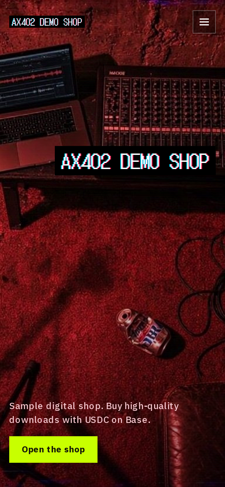

# Ax402 Demo Shop

Public **Cloudflare Workers** template for a digital-download shop that takes **USDC on Base**, verified by [Ax402](https://archonia.org). Stack: Worker + Static Assets + D1 + private R2 + Resend (+ optional Turnstile contact).



> You own the catalog and fulfillment. Ax402 verifies payment — it does **not** sell the sample demo SKUs.

**Demo brand:** Ax402 Demo Shop (neutral). Replace branding via [`docs/redesign.md`](docs/redesign.md).

## Deploy to Cloudflare

Official public repo: [`archoniaDev/ax402-demo-shop`](https://github.com/archoniaDev/ax402-demo-shop)

[](https://deploy.workers.cloudflare.com/?url=https://github.com/archoniaDev/ax402-demo-shop)

Full steps: **[docs/deploy.md](docs/deploy.md)**.

## What you get

- Catalog / cart / checkout for digital goods (sample album + tracks)
- Ax402 merchant quotes + USDC pay (wallet or paste tx hash)
- Private R2 fulfillment + email delivery
- Admin magic-link + catalog CRUD + About editor
- Optional contact form (Turnstile + Resend)
- SV/EN UI (`DEFAULT_LOCALE=en` in the template)

## Prerequisites

- Cloudflare + GitHub accounts
- Base wallet for your USDC payout
- Resend account (verified sending domain)
- Ax402 merchant key (`yogm_…`) from [archonia.org](https://archonia.org)

```bash
npm install
```

## Quick start (local)

```bash
cp .dev.vars.example .dev.vars
# Edit .dev.vars — mock pay + MAGIC_LINK_DEV_RETURN are enabled in the example

npm run migrate:local
npm run dev
# → http://localhost:8787
```

Smoke:

```bash
curl -s http://localhost:8787/health
curl -s 'http://localhost:8787/api/catalog?locale=en' | head
# Mock pay (requires AX402_ALLOW_MOCK=true in .dev.vars — never on a public store):
curl -s -i -X POST http://localhost:8787/api/orders \
  -H 'content-type: application/json' \
  -d '{"buyer_email":"buyer@example.com","locale":"en","items":[{"kind":"track","id":"trk-demo-01"}]}'
```

## Bindings

| Binding | Resource | Notes |
|---------|----------|--------|
| `DB` | D1 `shop-db` | Catalog, orders, download tokens, admin sessions |
| `AUDIO` | R2 `shop-audio` | Private files + covers — **no public object URLs** |
| `ASSETS` | `./public` | Static HTML/CSS/JS |

`wrangler.toml` ships a **placeholder** `database_id`. Create D1/R2 on your account (or use the Deploy button) before production deploy.

## Required secrets (names only)

Set with `npx wrangler secret put NAME` — **never commit values**.

| Secret | Purpose |
|--------|---------|
| `AX402_MERCHANT_KEY` | Merchant key `yogm_…` (server-side only) |
| `PAYOUT_ADDRESS` | Your USDC wallet on Base (must match Ax402 merchant) |
| `SESSION_SECRET` | Salt for magic-link / session / download token hashes |
| `RESEND_API_KEY` | Resend API key |
| `RESEND_FROM_EMAIL` | e.g. `Shop <noreply@example.com>` |
| `OWNER_BOOTSTRAP_EMAIL` | First owner email auto-created on magic link |
| `PUBLIC_BASE_URL` | Canonical URL for email/magic links |
| `SPOTIFY_CLIENT_ID` | Optional — cover fetch |
| `SPOTIFY_CLIENT_SECRET` | Optional — cover fetch |
| `TURNSTILE_SECRET_KEY` | Turnstile widget secret (contact Siteverify) |
| `CONTACT_TO_EMAIL` | Optional contact inbox (else `OWNER_BOOTSTRAP_EMAIL`) |

Vars in `wrangler.toml`: `AX402_API_URL`, `DEFAULT_LOCALE`, `TURNSTILE_SITE_KEY`, `TURNSTILE_HOSTNAMES`.

Template ships Cloudflare’s **dummy** Turnstile site key for local smoke — replace with your widget before production. See [docs/deploy.md](docs/deploy.md).

Optional Spotify covers: [docs/spotify-covers.md](docs/spotify-covers.md).  
Redesign (HTML/CSS/copy): [docs/redesign.md](docs/redesign.md).

## After deploy

1. Apply D1 migrations (`npm run migrate`)
2. Put secrets + real Turnstile site key / hostnames
3. Register Ax402 merchant with matching payout
4. Verify Resend domain; set `PUBLIC_BASE_URL`
5. `/admin/` → replace sample catalog; upload files to R2
6. Smoke `/health` + a test purchase from a **buyer** wallet (not the payout wallet)

## API (Worker)

| Method | Path | Notes |
|--------|------|--------|
| GET | `/api/catalog?locale=sv\|en` | Public catalog |
| GET | `/api/about` | Public About copy (D1, falls back to i18n defaults) |
| GET | `/api/contact` | Public Turnstile site key for the contact widget |
| POST | `/api/contact` | Contact form → Turnstile Siteverify → Resend |
| POST | `/api/orders` | Create order → **402** + payment payload |
| GET | `/api/orders/:id` | Order status |
| POST | `/api/orders/:id/pay` | `{ payment_data: { hash } }` → downloads |
| GET | `/api/download?token=` | Signed R2 download |
| POST | `/api/auth/request-link` | Admin magic link |
| POST | `/api/auth/callback` | Exchange token → session cookie |
| * | `/api/admin/*` | Albums/tracks/orders/about (session required) |

## License

MIT — see [LICENSE](./LICENSE).

Demo hero imagery is sample atmosphere for the template; replace before shipping your brand. Do not redistribute third-party masters or uncleared art as if they were yours.
